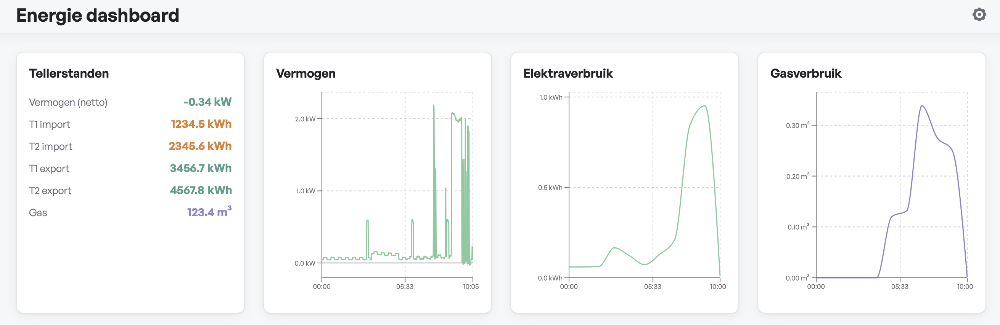
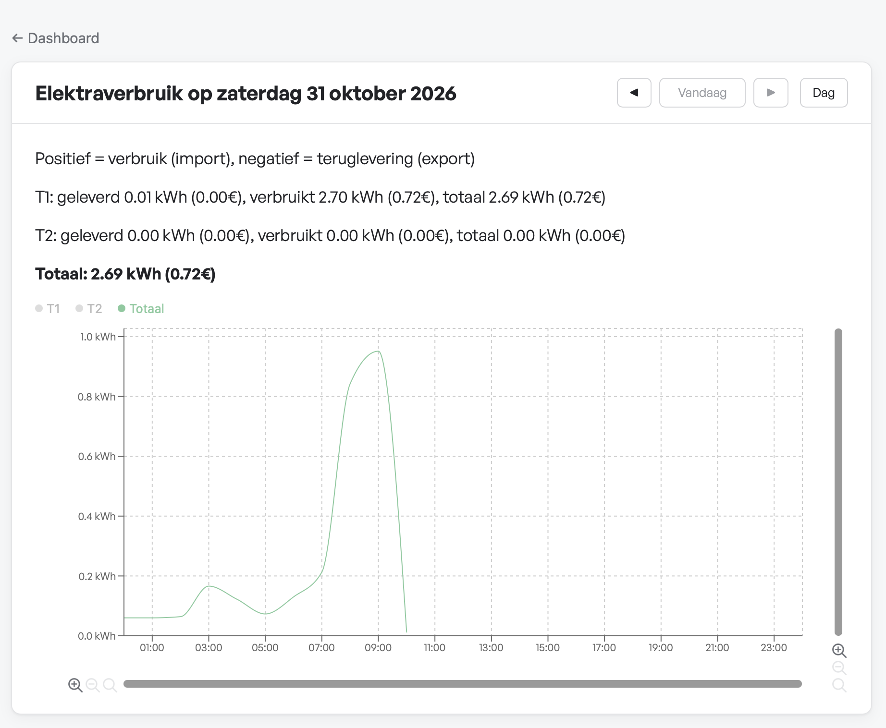
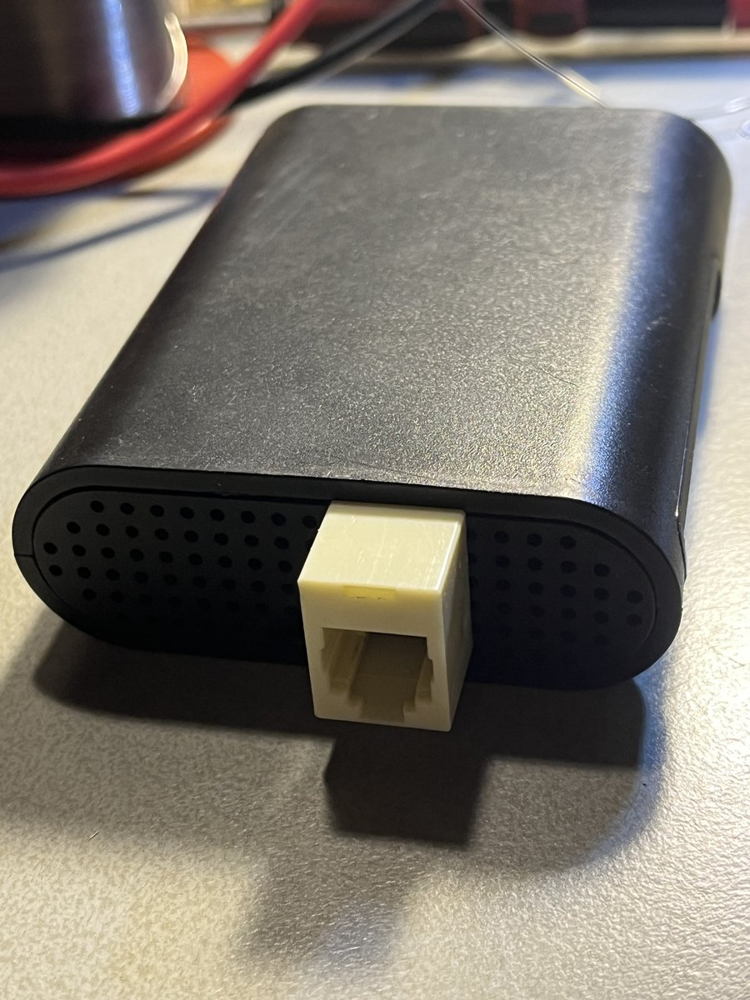
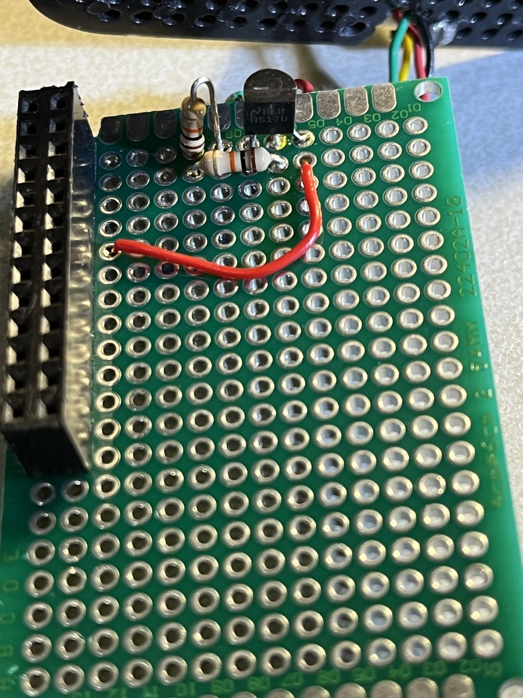

# p1-logger

A Rust daemon that reads a Dutch/Benelux smart meter's P1 port (DSMR5) over
UART on a Raspberry Pi, validates and parses the telegrams, and logs them to
SQLite — one file per UTC calendar day. Built to run unattended for months:
crash-safe writes (WAL), a read loop that never blocks on disk I/O, and
graceful handling of the line noise a real P1 cable might pick up.

A second binary, `p1-aggregate`, runs hourly via cron: it turns the raw
per-second readings into per-minute/per-day power aggregates and hourly
meter-reading snapshots (`data/aggregates.sqlite3`), then archives the raw
day-files it's fully processed.

A third, `p1-web`, serves a small web dashboard over the LAN: a React
frontend embedded into the binary at compile time, plus a JSON API reading
the aggregates (read-only — `p1-aggregate` is the only writer). Power,
electricity and gas per day/week/month/year/5 years, with zoom, and — if
tariffs are configured — what each period cost or earned.

The eventual goal beyond that is simple switching logic (water heater,
diverter valve, washing machine) based on momentary surplus/deficit from
solar.





## Why another P1 logger?

Existing options are great at what they do: DSMR-reader is a full web
application, Home Assistant's DSMR integration is part of a complete
home-automation platform, and ESPHome dongles add dedicated hardware. This
project is the minimal end of that spectrum:

- three small binaries and plain SQLite files: no Docker, no database server,
  deployed with a single `./run deploy`;
- reads the Pi's own UART through a two-part inverter (a BS170 and two
  resistors), no USB cable or dongle;
- keeps the raw per-second data next to the aggregates (optionally pruned
  after a retention window);
- shows import and export per tariff, with configurable tariff periods, so
  you can see what the end of net metering (salderen) costs you.

## How it's put together

- `src/parser.rs` — parses one DSMR5 telegram: CRC16/ARC validation, OBIS-code
  mapping, timestamp conversion (handles the S/W summer/winter flag), values
  converted to integer milli-units (no floats, ever).
- `src/telegram.rs` — frames raw serial bytes into complete telegrams. A
  small state machine (`AwaitingFirstHeader` / `Accumulating` / `AfterFooter`)
  distinguishes ordinary line noise from things that should never happen
  (data sitting in the gap between a footer and the next header).
- `src/db.rs` — one SQLite file per day, WAL mode, batched inserts.
- `src/io_source.rs` — opens a path as a live serial port if it's a character
  device, or reads it as a plain file otherwise. Lets the exact same binary
  run against real hardware or a captured telegram file for testing.
- `src/args.rs` — CLI argument parsing for `p1-logger`.
- `src/aggregate.rs` — the aggregation math (bucketing min/avg/max, hourly
  meter-reading snapshots) and the `power_1min`/`power_1day`/
  `meter_electricity`/`meter_gas` schema in `aggregates.sqlite3`, including
  its migrations (columns added after a database was first created get
  their own `ALTER TABLE`). Pure, DB-independent functions where possible,
  so the bucketing logic is unit tested without touching SQLite at all.
- `src/lib.rs` — re-exports the modules above so all binaries can share
  them.
- `src/main.rs` — `p1-logger`: setup and glue only. Parses args, wires up
  logging, spawns a writer thread connected to the reader via an unbounded
  channel (so a slow SD card can never stall the UART read), and dispatches
  `TelegramEvent`s.
- `src/bin/p1-aggregate/` — `p1-aggregate`: scans `data/` for day-files,
  computes and writes that day's aggregates in one transaction (idempotent:
  delete then insert, so a re-run or a mid-run crash never needs special
  handling), and archives the raw file to `data/processed/` once it's a
  completed (non-today) day. Moving archived files back into `data/` makes
  the next run re-aggregate them — the backfill path after a schema change.
- `src/bin/p1-web/` — `p1-web`: a `tiny_http` server with a small worker
  pool (plain threads, no async runtime). `api.rs` routes `/api/...`
  (series per metric and period, live meter readings, tariffs);
  `period.rs` turns a period + anchor into a calendar-aware range in the
  viewer's local calendar; `queries.rs` reads `aggregates.sqlite3` with
  short-lived read-only connections; `assets.rs` serves the embedded
  frontend, with an SPA fallback so deep links survive a reload;
  `config.rs` reads and validates the optional config file (tariffs).
- `frontend/` — the dashboard: React + TypeScript + Vite + SCSS, charts via
  Recharts. Built into `frontend/dist`, which `p1-web` embeds via
  `rust-embed`; `build.rs` warns at build time when that's missing.

## Building and running

```bash
./run <file>                  # run p1-logger against a file or a serial device path
./run build-frontend           # fetch the dashboard fonts if missing, npm install + build
./run npm <args...>            # run npm inside frontend/ (e.g. ./run npm audit)
./run build-dev                # cargo build (debug, native)
./run build-release            # cargo build --release (native)
./run build-pi                 # build-frontend, then cross-compile for the Pi
                               #   (aarch64-unknown-linux-gnu, via `cross`)
./run deploy                   # build-pi, then scp all three binaries + the systemd
                               #   units + the cron.d template to the Pi
./run view-log <type> [-f]     # journalctl on the Pi: p1-logger, p1-web or p1-aggregate
```

`p1-web` embeds `frontend/dist` at compile time, so the frontend has to be
built first — `build-pi` (and so `deploy`) does that itself. A plain
`cargo build` on a fresh clone still compiles everything, but a `p1-web`
built without the frontend refuses to start.

The dashboard uses the General Sans font (Fontshare), whose license allows
use but not redistribution — so the font files aren't in the repo, and
`./run build-frontend` downloads them from Fontshare when they're missing.

`./run deploy` reads `PI_HOST`/`PI_USER`/`RETENTION_DAYS` from a local
`.env` file (gitignored) — `PI_USER` (e.g. `john`) is substituted into the
`__PI_USER__` placeholder of [systemd/p1-logger.service](systemd/p1-logger.service),
[systemd/p1-web.service](systemd/p1-web.service) and
[cron.d/p1-aggregate](cron.d/p1-aggregate) at deploy time (used for both
`User=` and the `/home/__PI_USER__` paths), so no committed template
carries a personal username or path.
`RETENTION_DAYS` (optional) is substituted into the cron template's
`--retention-days` flag the same way — see below.

### CLI flags

```
p1-logger <serial-device-or-file> --data-dir <dir> [--bad-telegram-dir <dir>] [-d] [-l] [-q]
```

- `--data-dir` — required; where the day SQLite files go. No default, on
  purpose: the one caller that matters (the systemd unit) always passes an
  explicit absolute path, so a silent relative-to-CWD fallback would only
  ever paper over a forgotten flag.
- `--bad-telegram-dir` — if set, every rejected/anomalous telegram gets
  dumped there as a `<EventKind>-<timestamp>-<n>.txt` file, for offline
  inspection of what the actual noise looked like.
- `-d` — also print every parsed record to stderr (testing).
- `-l` — send warnings/errors also to syslog (`/dev/log`).
- `-q` — suppress stderr entirely. Normal unattended operation is `-l -q`.

```
p1-aggregate --data-dir <dir> [--retention-days <n>] [-l] [-q]
```

- `--data-dir` — required, same directory `p1-logger` writes its day-files
  into. `p1-aggregate` scans it for day-files, folds each completed day into
  `aggregates.sqlite3`, then moves the raw file into `<dir>/processed/`.
  Meant to run hourly via cron (see below) — re-running it is cheap and
  idempotent, so there's no harm running it more often than a day actually
  closes.
- `--retention-days` — optional; if set, every run also deletes archived
  raw day-files in `<dir>/processed/` older than this many days. The raw
  per-second data runs ~56MB/day, so left unbounded it eventually fills the
  Pi's SD card; `aggregates.sqlite3` itself stays tiny (tens of MB/year)
  and is never touched by this. Left unset, nothing is ever pruned. Set via
  `RETENTION_DAYS` in `.env` — `./run deploy` renders it into the cron
  template, so the retention window is a deploy-time decision, not
  something baked into the binary.
- `-l` / `-q` — same meaning as `p1-logger`'s own flags: send to syslog,
  suppress stderr. Off by default (handy when running by hand); the cron
  template passes `-l -q`, matching `p1-logger.service`'s own convention.

```
p1-web --data-dir <dir> [--bind <addr>] [--config <file>] [-l] [-q]
```

- `--data-dir` — required, the same directory: `p1-web` reads
  `aggregates.sqlite3` for the charts, and today's raw day-file for the live
  meter readings.
- `--bind` — listen address, default `127.0.0.1:8080` (never exposed to the
  network by accident). The systemd unit passes `0.0.0.0:8080`. There's no
  authentication, so only bind to a network you trust.
- `--config` — optional JSON settings file, read once at startup (see
  below). Without it, the dashboard just shows no prices.
- `-l` / `-q` — as above.

### Tariffs (optional)

With a `tariffs` key in the config file, the dashboard shows what each
period cost: per tariff (T1/T2) the energy taken from and delivered to the
grid, each with its price, plus gas. See
[p1-web.example.json](p1-web.example.json):

```json
{
  "tariffs": [
    {
      "until": "2026-12-31",
      "electricity": { "import_t1": 0.2104, "import_t2": 0.2398, "export_t1": 0.2104, "export_t2": 0.2398 },
      "gas": 1.2456
    },
    {
      "from": "2027-01-01",
      "electricity": { "import_t1": 0.2104, "import_t2": 0.2398, "export_t1": 0.05, "export_t2": 0.05 },
      "gas": 1.2456
    }
  ]
}
```

Prices are € per kWh and per m³. Each entry is a contract period with
inclusive `from`/`until` days in the viewer's local calendar: the first has
no `from`, the last no `until`, and each `from` is exactly the day after the
previous `until` — so every hour has exactly one price. Anything else (a
gap, an overlap, a typo'd key) is a startup error rather than a silently
wrong amount. Every hour is priced at the tariff of its own day, so periods
spanning a contract change still add up correctly. Leave out `tariffs` (or
use `{}`) for no prices; fixed costs (standing charges, grid fees, tax
credit) are deliberately not part of it.

## Hardware: reading the P1 port

### Wiring

The P1 connector is RJ12 (6P6C), but only pins 2–5 are used — an RJ11 (6P4C)
physically fits the same jack and covers exactly this range.

| P1 pin | Signal                          | Goes to                              |
|-------:|----------------------------------|---------------------------------------|
| 2      | REQUEST                          | Pi's own 5V (header pin 2) — *not* from the meter |
| 3      | Data-GND                         | Pi GND                                |
| 5      | Data (open-collector, inverted)  | Inverter circuit below, into RXD      |

Pin 1 (meter's own 5V) and pin 6 are unused — the Pi is powered separately.

### Inverter circuit (BS170)

The Pi's UART has no hardware invert bit (unlike an ESP32/STM32), and P1's
data line is open-collector and inverted, so a small MOSFET inverter sits in
between:

```
        +5V                                    +3.3V
         │                                        │
      ┌──┴──┐                                  ┌──┴──┐
      │ 10k │                                  │ 10k │
      └──┬──┘                                  └──┬──┘
         │                                        │
         ├── P1 pin 5 "DATA"                      ├── GPIO15 / RXD (header pin 10)
         │   (open-collector, inverted)           │
        Gate                                    Drain
         └──────────────[ BS170 ]────────────────┘
                             │
                          Source
                             │
                            GND ── P1 pin 3 "Data-GND"  +  Pi GND
```

**Why the gate pull-up is 5V but the drain pull-up stays 3.3V:** these are
two independent decisions, not a symmetric choice.

- The BS170's gate threshold voltage (Vgs(th)) varies per part, typically
  0.8–3V. With the gate pulled to only 3.3V, the "on" drive sits close to
  that threshold — not much margin, so a brief noise dip near the switching
  point could cause a false transition. Pulling the gate to 5V instead gives
  a lot more overdrive above the threshold, so the switch snaps decisively
  instead of lingering near the edge. The BS170's gate is rated for roughly
  ±20V, so 5V here is well within spec.
- The drain pull-up **must** stay on 3.3V, because the drain connects
  directly to GPIO15. Raspberry Pi GPIO pins are **not 5V-tolerant** — 5V on
  that side risks damaging the Pi.

So: gate side → 5V (more noise margin, safe for the MOSFET), drain side →
3.3V always (safe for the Pi). Don't swap these.

The whole thing fits on a small piece of perfboard on the Pi's GPIO header,
inside the Pi's own case, with an RJ12 jack for the P1 cable:

<p>
  
  
</p>

### Freeing up the UART on the Pi

By default, Bluetooth claims the full PL011 UART, leaving GPIO14/15 with the
inferior mini-UART (clock tied to CPU frequency, less stable). Disable it:

```bash
# /boot/firmware/config.txt, under [all]:
dtoverlay=disable-bt
```

Then disable the serial console/login shell (but keep the serial *hardware*
enabled) via `raspi-config`:

```bash
sudo raspi-config
# Interface Options -> Serial Port
#   "login shell over serial?"      -> No
#   "serial port hardware enabled?" -> Yes
sudo reboot
```

Verify after reboot:

```bash
dmesg | grep -i bluetooth        # should print nothing
ls -l /dev/serial0                # should symlink to /dev/ttyAMA0
```

Manual UART config for ad-hoc testing (the daemon itself already configures
this when it opens the port):

```bash
stty -F /dev/serial0 115200 cs8 -cstopb -parenb raw
```
Test:
```bash
cat /dev/serial0
```

## Deploying

```bash
./run deploy
```

That builds all three binaries, copies them to the Pi, and copies over the
rendered systemd units and cron.d template — but none of those take effect
until the one-time install step below is run once on the Pi (needs `sudo`;
`./run deploy` prints the exact same commands after it finishes):

```bash
sudo mv ~/p1-logger.service /etc/systemd/system/p1-logger.service
sudo mv ~/p1-web.service /etc/systemd/system/p1-web.service
sudo systemctl daemon-reload
sudo systemctl enable --now p1-logger
sudo systemctl enable --now p1-web

sudo mv ~/p1-aggregate.cron /etc/cron.d/p1-aggregate
sudo chown root:root /etc/cron.d/p1-aggregate
sudo chmod 644 /etc/cron.d/p1-aggregate
```

`/etc/cron.d` files are silently ignored unless owned by root and not
group/world-writable, which is why the `chown`/`chmod` above aren't optional.

After that, redeploys just need `./run deploy` + `sudo systemctl restart
p1-logger p1-web` — cron picks up an updated `p1-aggregate` binary on its own
next run, no reload needed. A changed unit file needs the `mv` +
`daemon-reload` again. See [systemd/p1-logger.service](systemd/p1-logger.service),
[systemd/p1-web.service](systemd/p1-web.service) and
[cron.d/p1-aggregate](cron.d/p1-aggregate) for the templates themselves
(`Restart=always`, runs as an unprivileged user).

The `p1-web` unit always passes `--config ~/p1-web.json`. On first deploy
`./run deploy` seeds that file as `{}` (no prices) so the dashboard works
out of the box; it never overwrites it after that. Add your tariffs there
and restart `p1-web`. The dashboard is then at `http://<pi>:8080/`.

## License

Licensed under either of [Apache License, Version 2.0](LICENSE-APACHE) or
[MIT license](LICENSE-MIT), at your option — the usual dual license in the
Rust ecosystem.

Unless you explicitly state otherwise, any contribution intentionally
submitted for inclusion in this project by you, as defined in the Apache-2.0
license, shall be dual licensed as above, without any additional terms or
conditions.
